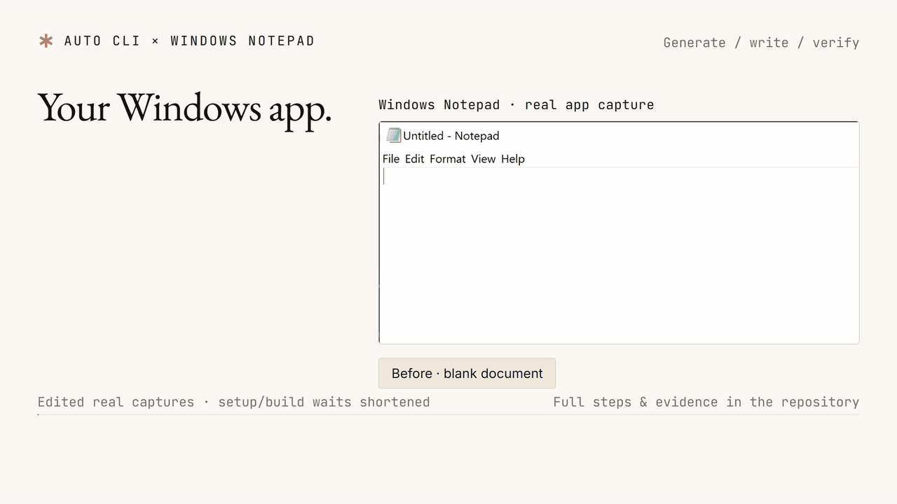
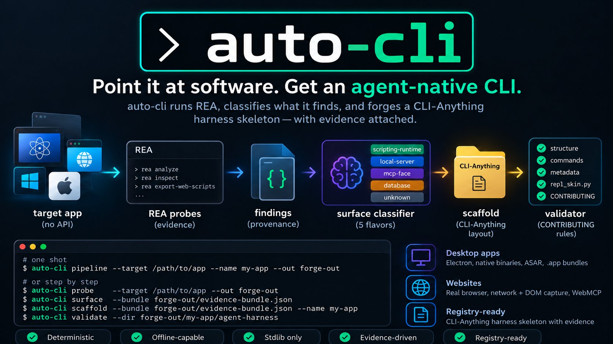

# auto-cli

**Point it at software. Get an agent-native CLI.**

> **Windows-first.** Live GUI testing has covered Windows Notepad and Calculator. The core unit suite also runs on Linux; broader app and platform coverage is still limited. Issues and PRs welcome.

### Getting started (3 steps)
1. Install Git, Python 3.10+ and Node.js (22.19+, 24.11+ or 26+), then `npm i -g rea-agents`.
2. `pip install "git+https://github.com/Northernator/Auto-CLI.git@main" pytest click prompt-toolkit`
3. Fetch CLI-Anything's repl skin, check REA, and generate:
   ```powershell
   Invoke-WebRequest -UseBasicParsing -Uri 'https://raw.githubusercontent.com/HKUDS/CLI-Anything/main/rms/agent-harness/cli_anything/rms/utils/repl_skin.py' -OutFile repl_skin.py
   python -m auto_cli doctor
   python -m auto_cli auto --target <app-or-folder> --name <name> --out out --repl-skin repl_skin.py
   ```

For a reproducible first example, paste the [full copy-and-paste quickstart](#copy-and-paste-quickstart-windows-powershell): it builds a small SQLite library app, generates its CLI, and exports a CSV.

*Auto-CLI is an independent project. It is not affiliated with [REA](https://github.com/morluto/rea) or [CLI-Anything](https://github.com/HKUDS/CLI-Anything); it uses REA's recon and outputs harnesses in CLI-Anything's layout.*

## A real Windows app, driven by its generated CLI



[Watch the MP4](docs/notepad-demo.mp4) · [Run the Notepad example](examples/notepad-demo.ps1) · [Demo source and evidence](videos/auto-cli-notepad/)

This demo uses the real Windows Notepad: Auto-CLI generates a harness from
recon and the live UI, then the generated commands write a release checklist,
read it back, and export the retrieved text to `release-notes.txt`. This is
an edited demonstration assembled from actual window captures and command
output; setup waits are shortened. The GUI uses the built-in Windows UIA
backend.

The demo was tested with classic English-language Notepad. Modern or
localized builds can expose different controls; inspect `ui-tree` before
reusing paths. The export writes the text returned by `ui-read-text` to a
local file; it does not invoke Notepad's Save command.



[REA](https://github.com/morluto/rea) (`npm i -g rea-agents`) reverse-engineers
software for agents. [CLI-Anything](https://github.com/HKUDS/CLI-Anything) is a
registry of hand-written CLI harnesses that make software agent-native. The
missing piece between them: REA tells you *what an app's automation surface
is*; CLI-Anything needs a human to write a harness over it. auto-cli is
that bridge — it runs the recon, classifies what it found, and forges a
registry-ready harness skeleton with the evidence attached.

```
target app ──► REA probes ──► findings ──► surface classifier ──► scaffold ──► validator
 (no API)      (evidence)     (provenance)   (4 flavors)        (CLI-Anything   (CONTRIBUTING
                                                               layout)         rules)
```

## Commands at a glance

| Command | What it does |
| --- | --- |
| `doctor` | check REA is reachable |
| `probe` | run REA recon (`--target` app path or `--url` website) → `evidence-bundle.json` |
| `surface` | classify a bundle into a harness plan (flavor + commands + risks) |
| `scaffold` | generate the CLI-Anything harness skeleton from a bundle |
| `pipeline` | recon → classify → scaffold → validate |
| `verify` | prove findings against the **live** app; patches constants, writes `VERIFICATION.md` |
| `drive` | attach to a running app's Inspector, exercise IPC channels, implement `send` |
| `complete` | generate table groups from readable schemas and commands for verified endpoints |
| `gui` | Windows GUI driving via UIA: tree capture + gated actions + scaffold upgrade |
| `auto` | recon → scaffold → verify → optional IPC drive → complete → optional GUI capture → validate |
| `validate` | check a harness against CLI-Anything CONTRIBUTING rules |

Classification and scaffold generation work offline from a saved bundle.
Probes, verification, IPC driving, and GUI driving depend on the target and
its environment. REA probe failures are recorded in the evidence bundle.

## Copy-and-paste quickstart (Windows PowerShell)

Install Git, Python 3.10+, and a supported Node.js version first; all three
must be on PATH. [REA's Node requirements](https://github.com/morluto/rea/blob/main/package.json)
are 22.19+ within 22.x, 24.11+ within 24.x, or 26+.

Paste this **whole block** into PowerShell. It creates an isolated
`auto-cli-demo` folder, installs from GitHub `main`, generates a working
library CLI, searches its books, and exports CSV. No environment activation
or execution-policy change is needed.

```powershell
& {
    $ErrorActionPreference = 'Stop'
    function Invoke-DemoNative {
        param([string] $Command, [Parameter(ValueFromRemainingArguments = $true)][string[]] $Arguments)
        & $Command @Arguments
        if ($LASTEXITCODE -ne 0) { throw "$Command failed (exit $LASTEXITCODE)" }
    }

    New-Item -ItemType Directory -Path auto-cli-demo -Force | Out-Null
    Push-Location auto-cli-demo
    $previousReaBin = $env:REA_BIN
    try {
        Invoke-DemoNative npm.cmd install --prefix .tools rea-agents
        $env:REA_BIN = (Resolve-Path .tools/node_modules/rea-agents/scripts/rea.mjs).Path
        Invoke-DemoNative python -m venv .venv
        $python = Join-Path $PWD '.venv\Scripts\python.exe'
        # pytest validates generated tests; Click and prompt-toolkit run the CLI.
        Invoke-DemoNative $python -m pip install 'git+https://github.com/Northernator/Auto-CLI.git@main' pytest click prompt-toolkit
        Invoke-DemoNative $python -m auto_cli doctor

        New-Item -ItemType Directory -Path library-demo -Force | Out-Null
        @'
import sqlite3
with sqlite3.connect('library-demo/library.db') as connection:
    connection.executescript("""
        CREATE TABLE IF NOT EXISTS books(id INTEGER PRIMARY KEY, title TEXT, author TEXT);
        INSERT OR IGNORE INTO books VALUES (1, 'Dune', 'Frank Herbert');
        INSERT OR IGNORE INTO books VALUES (2, 'The Left Hand of Darkness', 'Ursula K. Le Guin');
    """)
'@ | & $python -
        if ($LASTEXITCODE -ne 0) { throw 'Could not create the demo database' }

        # Validation needs CLI-Anything's actual repl skin.
        Invoke-WebRequest -UseBasicParsing -Uri 'https://raw.githubusercontent.com/HKUDS/CLI-Anything/main/rms/agent-harness/cli_anything/rms/utils/repl_skin.py' -OutFile repl_skin.py
        Invoke-DemoNative $python -m auto_cli auto --target library-demo --name library --out out --repl-skin repl_skin.py
        Invoke-DemoNative $python -m pip install --editable ./out/library/agent-harness
        $library = Join-Path $PWD '.venv\Scripts\cli-anything-library.exe'
        Invoke-DemoNative $library --json books list
        Invoke-DemoNative $library --json books search Dune
        Invoke-DemoNative $library export books books.csv --format csv
        Get-Content books.csv
        Write-Host "Generated CLI and CSV: $PWD"
    }
    finally {
        $env:REA_BIN = $previousReaBin
        Pop-Location
    }
}
```

Expect `result: OK`, a search result containing `Dune`, and a CSV containing
both books. The generated harness and reports are in
`auto-cli-demo/out/library/agent-harness/`. Auto-CLI itself has no required
runtime packages; the block explicitly installs the generated harness's
runtime and validation dependencies.

To try the live Windows app shown above, follow
[the Notepad example](examples/notepad-demo.ps1) after this setup. It uses
the same virtual environment and installs the optional `uiautomation`
package for the GUI leg. To inspect an already-running app directly:

```powershell
& .\auto-cli-demo\.venv\Scripts\python.exe -m pip install uiautomation
& .\auto-cli-demo\.venv\Scripts\python.exe -m auto_cli gui --backend local --process Notepad --tree
```

`--process` matches a window's **ClassName**, not the executable filename;
`--pid` or `--title` can select another window. Supplied selectors must
all match, and multiple matching windows require a narrower selector.
Use paths from `--tree`
when driving it, since controls and titles vary by application version.

The optional [rea-windows provider](https://github.com/Northernator/rea-windows#install-into-a-rea-source-checkout)
captures REA evidence envelopes. Its setup requires a REA source checkout,
the provider's Bash installer, Python with uiautomation and Pillow, and
compiling the patched REA checkout. Follow that repository's current build
instructions, then set the PowerShell variables shown in the GUI section.

REA is located via `REA_BIN` first, then `rea` on PATH, then an `npx`
fallback (which may download REA).

## Usage

One shot:

```bash
auto-cli pipeline --target /path/to/app --name my-app --out forge-out
```

Or step by step:

```bash
auto-cli probe    --target /path/to/app --out forge-out     # REA probes -> evidence-bundle.json
auto-cli surface  --bundle forge-out/evidence-bundle.json   # classify -> harness plan
auto-cli scaffold --bundle forge-out/evidence-bundle.json --name my-app --out forge-out
auto-cli validate --dir forge-out/my-app/agent-harness      # CONTRIBUTING.md checks
```

The multi-line examples below use Bash syntax; in PowerShell put the
command on one line or replace a trailing `\` with a backtick.

Options: `--probe <cmd>` (repeatable) to restrict REA commands,
`--repl-skin <path>` to drop the plugin's unmodified `repl_skin.py` into the
generated harness (CONTRIBUTING.md requires a real copy), `--author` for the
registry entry.

Pass `--repl-skin repl_skin.py` to the `scaffold`, `pipeline`, and `auto`
examples below for validation to pass. Without it, generation still works but the
placeholder skin deliberately fails validation (exit 2).

## Pointing it at things

**Desktop apps — pass a path.** These target forms are accepted; useful
findings depend on the app and the available REA providers:

```bash
# extracted Electron app directory (app.asar or .js files)
auto-cli pipeline --target ~/AppData/Local/Programs/SomeApp/resources/app --name some-app

# the .asar itself
auto-cli pipeline --target /Applications/SomeApp.app/Contents/Resources/app.asar --name some-app

# a macOS .app bundle
auto-cli pipeline --target /Applications/SomeApp.app --name some-app

# a Windows install directory or the .exe (native binary recon)
auto-cli pipeline --target "C:/Program Files/SomeApp" --name some-app
```

The forge picks probes from what it sees: `analyze` always,
`analyze-javascript-application` when the target contains JS/ASAR,
`inspect-sqlite-database` when it finds a `.db`/`.sqlite` file. Force any REA
command with `--probe` (repeatable), e.g. `--probe inspect-macho`.

**Websites — pass `--url`.** REA drives a real Chrome-family browser:

```bash
auto-cli pipeline --url https://example.com --name example-site
```

The chain: launch browser → navigate → settle → capture DOM + network (with
response bodies) → `export-web-scripts` → `analyze-javascript-application` on
the exported scripts. Browser auto-detects Chrome/Edge (override with
`--browser PATH` or `$HARNESS_FORGE_BROWSER`); tune the settle time with
`--wait-ms`.

For WebMCP discovery you need a running debug browser:

```bash
# terminal 1: chrome --remote-debugging-port=9222
auto-cli pipeline --url https://some-app.com --cdp http://127.0.0.1:9222 --name some-app
```

With `--cdp`, the forge also runs `list-browser-targets`,
`discover-webmcp-tools`, and `analyze-web-bundle` against the matching target
— WebMCP findings map to the mcp-face flavor.

**What "found nothing" looks like:** a static page (no API, no bundles worth
analyzing) honestly yields flavor `unknown` with a todo to run deeper probes.
That is the tool working, not failing.

## What the classifier looks for

| Flavor | REA signal | Suggested surface |
| --- | --- | --- |
| local-server | loopback endpoints (`127.0.0.1:PORT`), Electron IPC channels, context-bridge APIs | `get`, `endpoints`, `channels`, `send` |
| database | SQLite files in the app bundle | `info`, `schema`, `backup`, `query`, `export` |
| mcp-face | WebMCP tools / MCP servers | `tools`, `call` (requires implementation) |
| scripting-runtime | embedded Python/JS consoles | `eval` (requires implementation) |

The base scaffold includes the database, HTTP, and IPC inventory commands
regardless of flavor. MCP and scripting commands are classifier suggestions;
they are not generated implementations. `unknown` means no supported
automation surface was found.

Databases trigger the Rekordbox rule: **backup before any write**. The
generated backend opens SQLite read-only (`mode=ro`), allows
`SELECT`/`WITH`/`EXPLAIN` query prefixes, rejects multi-statement input, and
`backup` refuses to clobber. HTTP
`get` is origin-scoped: loopback always, remote hosts only if recon
discovered them. `send` (IPC) starts as a stub and gets a real
implementation from `drive` once a channel is confirmed live.

## What it generates

```
<name>/agent-harness/            # standard CLI-Anything layout
  <NAME>.md                       # SOP doc
  setup.py                        # entry point cli-anything-<name>
  cli_anything/<module>/
    <module>_cli.py               # Click CLI, global --json before the command
    core/backend.py               # constants baked in from recon + guards
    skills/SKILL.md               # agent-facing manual
    tests/test_core.py            # 8 unit tests, no backend needed
    utils/repl_skin.py            # placeholder unless --repl-skin given
  FORGE-REPORT.md                 # audit trail: probes, findings, risks, todos
  registry-entry.json             # registry.json fragment with all fields
```

Install a generated harness with
`python -m pip install -e ./forge-out/my-app/agent-harness` (replace the path).
For JSON output, use
`cli-anything-my-app --json <command>`. GUI-upgraded harnesses also need
uiautomation in that Python environment; they use their own local UIA
runner even when REA captured the original tree.

## Closing the loop: verify against the live app

Static recon says an endpoint exists. `verify` asks the endpoint:

```bash
# with the target app actually running
auto-cli verify --bundle forge-out/evidence-bundle.json --dir forge-out/my-app/agent-harness
```

Per finding it records `verified` / `corrected` / `failed` / `unverifiable`,
patches corrected constants into the generated backend, and writes
`VERIFICATION.md` + `verification.json`. IPC channels are honestly marked
unverifiable (static observation only). 502/503/504 on loopback is flagged as
possible proxy interception, not app behavior.

### The full agent loop

```bash
auto-cli pipeline --target ./my-app --name my-app        # recon + scaffold + validate
# start the app's backend...
auto-cli verify --bundle forge-out/evidence-bundle.json \
    --dir forge-out/my-app/agent-harness                      # prove findings live
# agent (or you) reads VERIFICATION.md, adds domain commands + workflows + tests
auto-cli validate --dir forge-out/my-app/agent-harness   # final gate
```

### Previous demo experiment: how far does an agent get?

The following records an earlier demo run (Electron-style JS + SQLite
library + live REST backend on the port REA found in its source). It is an
example outcome for that app, not a guarantee for arbitrary targets.

| Step | Who | Outcome |
| --- | --- | --- |
| recon (REA probes) | tool | endpoint + 4 IPC channels + DB found, statically |
| scaffold | tool | full CLI-Anything layout, working generic commands |
| verification | tool | endpoint proven live: `200 application/json, keys=['tracks']`; DB schema verified; constants patched |
| domain command `tracks` | agent | added from the verified response shape |
| SKILL.md workflows | agent | written from verified shapes (incl. "bare origin 404s") |
| regression tests | agent | 2 added (verified-shape parse, non-200 rejection) |
| final validation | tool | 9 commands, 10/10 tests, `result: OK` |

The agent's response-parsing bug was caught by its test in one iteration.
IPC `send` needs a live app session (`drive` can wire confirmed channels).
Choosing the command surface and reviewing the resulting harness still
require judgment.

## Driving live sessions: the `drive` command

IPC `send` needs a live app session. In this command, REA observes the
runtime while Auto-CLI evaluates the channel probes and records results.

```bash
# app already running with an inspector (Electron: --remote-debugging-port,
# Node: --inspect=9229)
auto-cli drive --bundle forge-out/evidence-bundle.json \
    --dir forge-out/my-app/agent-harness \
    --inspector http://127.0.0.1:9229

# or let the forge launch it
auto-cli drive --bundle ... --dir ... \
    --launch "node --inspect=9229 app.js" --cwd /path/to/app
```

What happens: REA lists and observes the live runtime (witnessed evidence),
the forge evaluates inventory + send probes against the target, every channel
that responds is recorded with its actual response, and the scaffold is
upgraded — `send` gets a real implementation (a dependency-free Node CDP
client at `utils/inspector_send.mjs`), `LIVE_CHANNELS`/`INSPECTOR_ENDPOINT`
are baked into the backend, tests and SKILL.md are updated, and
`DRIVE-REPORT.md` records the session. Channels that never respond stay
unsendable (exit 2).

In the earlier demo run, REA observed the runtime, the inventory probe
returned `["library:load","library:export"]`, both channels were driven
(`library:load` → `{"ok":true,"tracks":1}`), and the generated
`cli-anything-demo-dj send library:load` returned that same response from the
running app.

## GUI-only apps on Windows: the `gui` command

The GUI leg has two backends. **REA** (preferred) delegates to the
`native-windows` provider from
[rea-windows](https://github.com/Northernator/rea-windows), so GUI evidence
is a real REA evidence envelope. The **built-in** UIA driver is the standalone
fallback for hosts without the provider. Choose with
`--backend auto|rea|local`; auto probes REA and falls back when unavailable.

```bash
# auto: REA when available, built-in otherwise
auto-cli gui --process Notepad --tree

# request a specific backend
auto-cli gui --backend rea  --process Notepad --window-id 787822 --tree
auto-cli gui --backend local --process Notepad --tree
```

To use the REA backend, follow the provider's installation and compilation
instructions linked above, then point the forge at that checkout:

```powershell
$env:REA_BIN = "C:\path\to\rea\scripts\rea.mjs"
$env:REA_WINDOWS_PYTHON = (python -c "import sys; print(sys.executable)")
auto-cli gui --backend rea --process Notepad --tree
```

Upstream REA's built-in native-UI provider is macOS-only; rea-windows adds
Windows support. Auto-CLI's local backend independently drives UI Automation
with the uiautomation package installed above:

```bash
# read-only: capture the actionable tree
auto-cli gui --process Notepad --tree

# drive it (every action needs --yes; destructive paths need --allow-destructive)
auto-cli gui --title "Untitled" --yes \
    --set-text "PaneControl > Text editor=hello" \
    --invoke "PaneControl > PaneControl > Headings" \
    --dir forge-out/my-app/agent-harness        # upgrade the scaffold too
```

What it captures: UIA nodes up to the configured depth and node limit,
with their patterns (Invoke / Value / ExpandCollapse / SelectionItem /
Toggle), plus expandable menu paths. Successful actions can include a
window screenshot. Paths accept suffixes; choose an unambiguous path from
the captured tree.

Safety model: `tree`/`menus` are read-only; every driving action requires
`--yes`; paths matching save/close/delete/exit/format are refused even with
`--yes` unless `--allow-destructive`.

The scaffold gets top-level `ui-*` commands backed by a self-contained
`utils/uia_runner.py` copied into the harness (no auto_cli dependency at
runtime): `ui-tree`, `ui-menus`, `ui-read-text`, `ui-invoke`, `ui-select`,
`ui-set-text`. Tree capture, menu listing, and text reads are read-only;
actions require `--yes` and failures exit 2. These generated commands
refuse destructive-looking paths; the generated CLI does not expose the
runner's `--allow-destructive` override. The harness stores the captured
window's process ID, class, and title to target that app session. Restarting
the app or changing the document's title can require regenerating the
harness or recapturing its GUI target.

And it's wired into `auto`:

```bash
auto-cli auto --target "C:/Windows/System32/notepad.exe" --name notepad \
    --gui-process Notepad --gui-title "Untitled"
```

An earlier run on an untitled Notepad reported 51 nodes / 8 menu paths,
a scaffold upgrade, `result: OK`, and text written through the generated
`ui-set-text`. UIA exposure varies between Notepad builds; capture and test
the installed version before relying on those paths.

### Platform boundaries

- **GUI driving is built for Windows.** Use the built-in UIAutomation
  backend or the optional rea-windows provider. `gui` records action
  results and available screenshots; `--gui-*` flags add GUI capture and
  scaffold upgrade to `auto`.
- **`capture-process` is unavailable on native Windows** — REA's PTY adapter
  requires Linux/WSL/macOS. Recorded as a failed probe with REA's own message,
  never a crash.
- **Recon and driving are separate.** `drive` exercises live IPC channels;
  GUI actions run through the local UIA driver or the optional provider
  with explicit action flags and confirmation gates.
- Proxy environments: 502/503/504 on loopback is flagged as proxy-suspect, not
  app behavior.

## Fully automatic: the `auto` command

One command, no agent in the loop:

```bash
auto-cli auto --target ./my-app --name my-app \
    --inspector http://127.0.0.1:9229 \
    --repl-skin /path/to/plugin/repl_skin.py --repair
```

Chain: recon → scaffold → (launch app if `--launch` given) → verify → drive →
**complete** → validate (+ one repair pass with `--repair`). Works for
`--target` and `--url`.

`complete` generates the domain surface from readable database schemas and
verified endpoint checks: one command group per supported database table
(`list`/`get`/`search`/`add`/`update`/`delete`), one command per verified
endpoint, database tests, and a SKILL.md documenting the additions.
An endpoint that failed verification gets no command; POST endpoints remain
stubs requiring auth and request-body wiring.

Safety is structural: reads use a read-only connection, writes require `--yes`
and take a timestamped backup first, identifiers are quoted, payloads are
validated against the live schema.

### What `auto` produced in the previous demo run, unattended

```
verify:  {'unverifiable': 5, 'verified': 2, 'failed': 1}
drive:   ['library:export', 'library:load'] confirmed live
table groups: tracks, playlists, playlist_tracks
endpoint commands: library-tracks
result: OK
```

That run exercised the generated commands against its live app: `tracks list`,
`tracks search Solar`, `library-tracks` (verified endpoint, parsed JSON),
`send library:export --message '{"format":"m3u"}'` (live channel),
`tracks add --yes` (backup taken, row inserted). `add` without `--yes` exits 2.

## What it deliberately does NOT do

- **It does not implement every app-specific workflow.** `scaffold` produces
  generic commands; `drive`, `complete`, and `gui` can add working surface
  from live evidence. MCP, scripting, auth, POST bodies, and unsupported
  transports still need implementation and review. `FORGE-REPORT.md` records
  findings, available provenance, and open questions.
- **It does not launch arbitrary desktop apps by default.** Filesystem recon
  is static. `--url` launches a browser, `--launch` starts the supplied
  command, and IPC/GUI driving needs an accessible live target.
- **It does not benchmark agents.** No success-rate claims.

## Development

```bash
pip install -e ".[dev]"
python -m pytest tests/ -q
```

Layout: `rea_client` (locate/drive REA), `evidence` (envelope → findings),
`surface` (findings → plan), `scaffold` (plan → files), `verify` (live
endpoint/DB checks), `drive` (live-session channel driving + scaffold
upgrade), `complete` (evidence-driven domain-surface generation), `validate`
(CONTRIBUTING.md rules). REA capability failures (e.g. a probe needing a
newer Node, PTY capture on Windows, macOS-only UI observation) are recorded
as limitations, never crashes.
